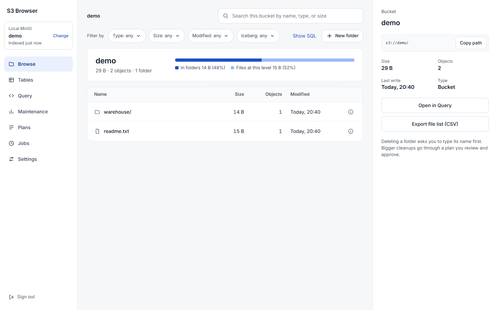
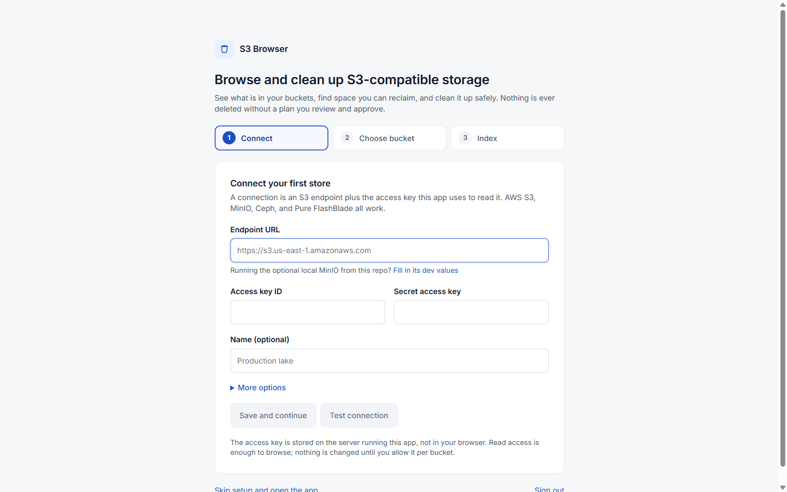
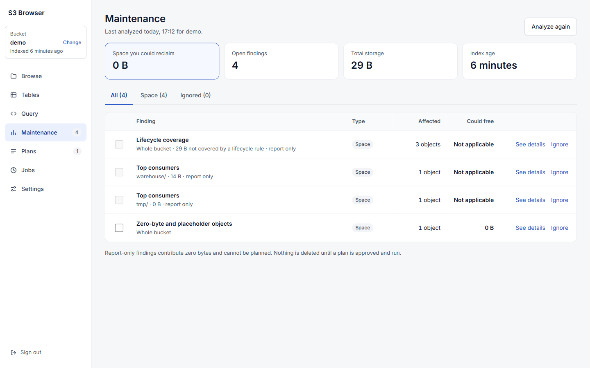
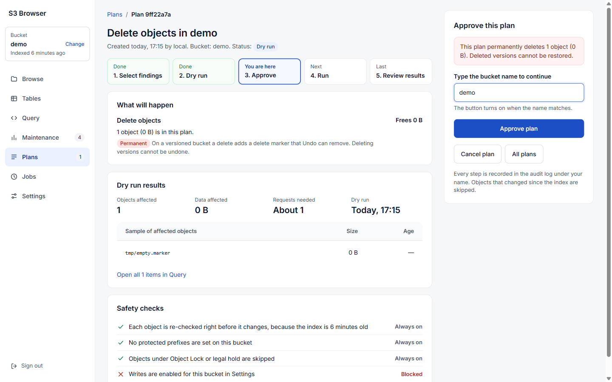

# S3 Browser

A browse-and-maintenance tool for S3-compatible storage (AWS S3, MinIO, Ceph, Pure Storage FlashBlade, and others).

- **See what is in a bucket**: folders and files with sizes, object counts, and last-write dates, plus search, filters, previews, and SQL.
- **Find space you can reclaim**: analyzers flag old data, old object versions, duplicates, zero-byte objects, and unfinished multipart uploads.
- **Clean up safely**: nothing is deleted without a plan you dry-run, review, and approve by typing the bucket name. Writes are off per bucket until you turn them on, and every change goes in an audit log.

One process serves the web UI and the API. It keeps a local [DuckDB](https://duckdb.org) index of each bucket so browsing and queries are fast and add no load to your store.



## Quick start (Docker)

```bash
docker compose up -d --build
```

1. Open http://localhost:8080.
2. Sign in with the app token. The dev default is `local-dev-token` (see [Configuration](#configuration) to change it).
3. Follow the three-step setup: **Connect** a store, **Choose** a bucket, **Index** it. You land in Browse.

The app starts with no stores. Don't have one handy? Start the [optional local MinIO](#optional-local-minio) and connect to it.



> `local-dev-token` is a development default. Set `T4_TOKEN` to a long random value before the app is reachable by anyone else.

## How it works

### Connections
A connection is one S3 endpoint plus the access key the app uses for it: endpoint URL, region, path-style or virtual-hosted addressing, and TLS settings. Keys are stored on the server in `<data dir>/secrets.json`, never in DuckDB or the browser. Manage connections in **Settings → Connections**: test, rotate the access key, create or delete (empty) buckets, edit a bucket policy, or remove the connection. Removing a connection asks you to type its name. Its buckets stop being indexed and their local index is cleared; nothing in the store is deleted.

### Buckets
Pick the active connection and bucket from the **Bucket** card at the top of the sidebar (**Change**). Every screen works on that bucket, and the choice is remembered. Each bucket has its own settings under **Settings → Indexed buckets**: the write toggle, protected prefixes, and a probe of which S3 features the store supports.

### Indexing
Indexing lists the bucket once (read-only) and stores keys, sizes, dates, versions, and storage classes in a local DuckDB file. Browse, search, Tables, Query, and the analyzers all read this index instead of calling S3 each time. That makes large buckets fast to explore and keeps request costs flat. The index is a snapshot: re-index from **Settings → Indexed buckets → Index now** (or after a folder change, which re-indexes that prefix automatically). Jobs shows progress. The sidebar card shows how old the index is.

### Browse
Folders and files at the current prefix, with total size, object count, and last write. Click a folder to open it (the URL updates, so Back works). Click ⓘ or a file to see details on the right: copy the `s3://` path, preview CSV/JSON/Parquet, download through a short-lived signed link, open in Query, or export a file list as CSV. Filter chips narrow by type, size, modified date, or Iceberg; **Show SQL** reveals the query behind the view. **New folder** and **Delete folder** need writes enabled on the bucket. Deleting asks you to type the folder name and shows how many objects and bytes it removes.

### Tables (Iceberg)
Folders that hold Apache Iceberg tables (found from `metadata/*.metadata.json` while indexing) are listed with size, file counts, a file-size histogram, and copyable maintenance statements (compaction, snapshot expiry, orphan cleanup) for your table engine. This tool never deletes files inside an Iceberg table.

### Query
A SQL console over the index (DuckDB). One `SELECT`, `DESCRIBE`, `EXPLAIN`, or `SUMMARIZE` at a time; writes and local file reads are rejected. Useful tables: `objects`, `prefix_stats`, `findings`, `iceberg_tables`, `jobs`. Results export to CSV or Parquet, and queries can be saved.

### Maintenance
Analyzers read the index (and, where needed, live listings) and produce **findings**: old data, noncurrent versions, duplicates, zero-byte objects, incomplete multipart uploads, small files, lifecycle-rule coverage, key hygiene, top consumers, and more. Each finding shows what it affects and how much space it could free. Report-only findings are advice and cannot be planned. Analyzer definitions live in `packages/core/analyzers/`.



### Plans
Select findings and **Create plan**. A plan moves through: **dry run** (counts objects, bytes, and requests without changing anything) → **approve** (type the bucket name) → **run** (type it again) → review. Every object is re-checked right before it changes, and objects that changed since indexing are skipped. On a versioned bucket, deletes add delete markers and **Undo** removes them.



### Jobs
Background work: indexing and analyzer runs, with progress, results, and errors. The page refreshes itself.

### Safety model
- **Read-only by default**: each bucket has a write toggle (**Allow plans to change this bucket**). While it is off, plans can be dry-run and approved but not run, and folder/bucket deletes are refused.
- **Protected prefixes**: per bucket. Plans skip them, and folder deletes that touch them are refused.
- **Object Lock and legal hold**: locked objects are always skipped.
- **Type to confirm**: approving or running a plan, deleting a folder or bucket, and removing a connection all require typing the exact name.
- **Kill switch**: `PUT /api/settings/kill_switch` with `{"value":"true"}` pauses every write.
- **Audit log**: every plan step, folder or bucket change, and connection removal is recorded (`GET /api/audit`). The actor name comes from `T4_ACTOR` or the `x-t4-actor` header.
- Non-empty buckets are never deleted; empty them first.

## Optional local MinIO

`docker-compose.minio.yml` adds a MinIO server and seeds a `demo` bucket. Run both files together:

```bash
docker compose -f docker-compose.yml -f docker-compose.minio.yml up -d --build
```

Then connect to it in the app (the first-run screen has a **Fill in its dev values** link):

| Field | Value |
| --- | --- |
| Endpoint URL | `http://minio:9000` (the app reaches MinIO by its service name) |
| Access key ID | `t4admin` |
| Secret access key | `t4secret-change-me` |
| Region | `us-east-1` |
| Address style | Path style |

The seeded `demo` bucket contains `readme.txt` and `warehouse/users/users.csv`. The MinIO console is at http://localhost:9001 (same credentials). From your host, MinIO's S3 API is http://localhost:9000. These credentials are for this local stack only.

To stop everything, use the same `-f` flags with `down`. Add `-v` to also delete the app index and MinIO data.

## Configuration

Docker Compose reads a `.env` file next to `docker-compose.yml`; copy `.env.example` to start.

| Variable | Default | Purpose |
| --- | --- | --- |
| `T4_TOKEN` | Compose: `local-dev-token`. pnpm: generated | Login token for the UI and API (`Authorization: Bearer …`). Without Docker, if unset, the API writes a random token to `<data dir>/dev-token.txt` and reuses it. |
| `T4_PORT` | `8080` | Host port in Docker Compose. |
| `T4_ACTOR` | `local` | Name written to the audit log. |
| `T4_DATA_DIR` | Compose: `/data` (volume `t4-data`). pnpm: `<repo>/data` | DuckDB index, `secrets.json` (connection keys), exports, dev token. Back it up; never commit it. |
| `PORT` / `HOST` | `8080` / `0.0.0.0` | API listen address. |
| `T4_DUCKDB_MEMORY` / `T4_DUCKDB_THREADS` | DuckDB defaults | DuckDB resource limits. |
| `T4_WEB_DIST` | Docker image: built UI | Absolute path of a built UI for the API to serve. |
| `T4_MINIO_PORT` / `T4_MINIO_CONSOLE_PORT` | `9000` / `9001` | Host ports for the optional MinIO. |
| `T4_S3_*` | unset (off) | Optional: pre-create one connection at startup. Only active when both `T4_S3_ENDPOINT` and `T4_S3_BUCKET` are set. Also used by `pnpm seed`. See `.env.example`. |

## Development without Docker

Requires Node.js 22+ and pnpm 10 (`corepack enable`).

```bash
pnpm install
pnpm dev        # API on :8080 (tsx watch) + Vite UI on :5173 with /api proxied
```

Open http://localhost:5173. The token is printed as `Dev token written to …/data/dev-token.txt` the first time; paste the file's contents. To try against the optional MinIO, run only that service (`docker compose -f docker-compose.minio.yml up -d`) and connect to `http://localhost:9000` from the UI, since the API now runs on your host.

Other scripts: `pnpm build`, `pnpm start` (API only), `pnpm typecheck`, `pnpm seed` (writes the demo objects using `T4_S3_*`).

## Tests

```bash
pnpm test        # core (vitest, in-memory store + DuckDB) and API (fastify inject)
pnpm typecheck
```

## Project layout

```
apps/
  api/          Fastify server: REST API under /api, serves the built UI, schedules
  web/          React + Vite UI (TanStack Query, Monaco for SQL)
packages/
  core/         Workspace logic: DuckDB index, crawler, analyzers, plan engine, S3 store
    analyzers/  One folder per analyzer: manifest.yaml, find.sql, items.sql
docs/
  design/       Product design doc and the UI design mock (open ui-design.html in a browser)
  screenshots/  Images used in this README
docker-compose.yml        App only
docker-compose.minio.yml  Optional local MinIO + demo data
```

The OpenAPI document is served at `/api/openapi.json`.
